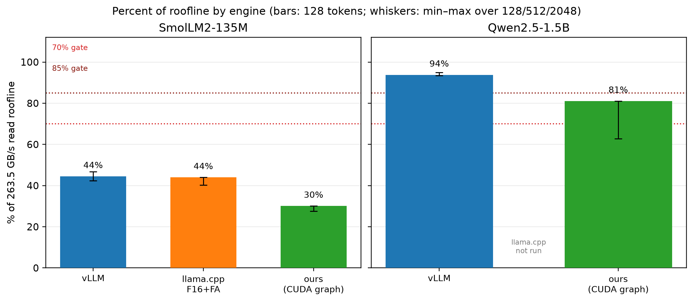
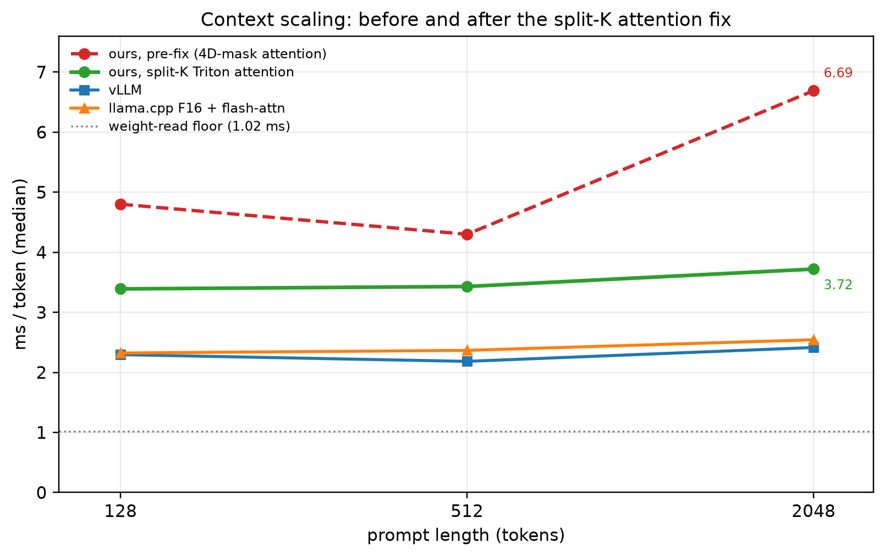
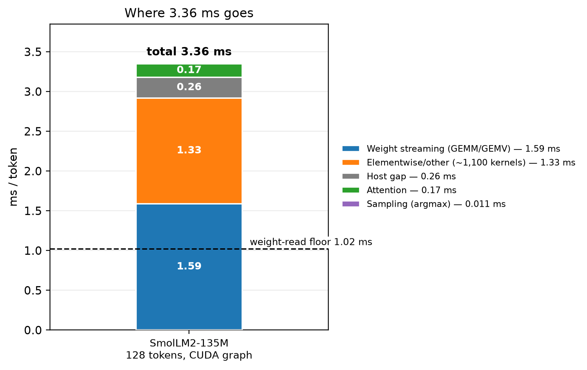

# MegaKernel on a 4060

Batch-1 LLM decode on an RTX 4060 Laptop GPU: a measured memory roofline, honest
baselines (vLLM, llama.cpp, torch eager / `torch.compile` / CUDA graphs), and a
split-K Triton decode-attention kernel.

**Status: Part 1 complete. The persistent megakernel / Triton fusion is not
implemented yet.** This repository contains the measurement harness, the
baselines, the context-scaling fix, and the article figures.

---

## Headline results

All numbers are batch-1, greedy decode, median over 50 steps, measured under the
overclock described below.

**SmolLM2-135M** (0.269 GB weights, 1.02 ms weight-read floor):

| runtime | 128 tok | 512 tok | 2048 tok |
|---|---|---|---|
| llama.cpp F16 + flash-attn | 2.32 ms (44.0%) | 2.37 ms (43.1%) | 2.54 ms (40.2%) |
| vLLM (CUDA graphs) | 2.30 ms (44.5%) | 2.18 ms (46.8%) | 2.41 ms (42.3%) |
| ours: CUDA graph | **3.39 ms (30.1%)** | **3.43 ms (29.8%)** | **3.72 ms (27.5%)** |
| ours: `torch.compile` | 7.40 ms (13.8%) | 7.85 ms (13.0%) | 6.94 ms (14.7%) |
| ours: eager | 20.71 ms (4.9%) | 21.65 ms (4.7%) | 21.84 ms (4.7%) |

**Qwen2.5-1.5B** (3.087 GB weights, 11.72 ms floor):

| runtime | 128 tok | 512 tok | 2048 tok |
|---|---|---|---|
| vLLM (CUDA graphs) | 12.49 ms (93.8%) | 12.34 ms (95.0%) | 12.54 ms (93.4%) |
| ours: CUDA graph | 14.45 ms (81.1%) | 15.46 ms (75.8%) | 18.68 ms (62.7%) |

Percentages are of the **263.5 GB/s sustained read** roofline used throughout.
llama.cpp was not run on Qwen2.5-1.5B.

**Conclusion:** on SmolLM2-135M, vLLM and llama.cpp are tied at ~40–47% of the
roofline; our fixed CUDA graph is ~27–30%. On Qwen2.5-1.5B, vLLM is already at
~94% of the achievable roofline. The 135M model is therefore the optimization
target; the 1.5B model is the “already at roofline” contrast.

---

## The context-scaling fix

The first CUDA-graph path was not flat: **4.80 / 4.30 / 6.69 ms** at 128 / 512 /
2048 tokens, while vLLM stayed near 2.3–2.4 ms. `torch.profiler` showed attention
growing from **0.33 ms to 2.99 ms**.

Cause: the static cache’s 4D causal mask makes PyTorch SDPA use the
memory-efficient CUTLASS kernel, which is slow for a single query token and
scales with KV length. `bench/fastattn.py` patches `LlamaAttention` for
`q_len == 1 + StaticCache + bf16` and calls a **split-K Triton kernel**
(16 splits per head, online softmax, then a reduction). It reads the cache length
from the device-side `cumulative_length`, so shapes stay fixed and the kernel
remains CUDA-graph-safe.

Result: attention at 2048 fell from **2.99 ms to 0.50 ms**, and the graph became
**3.39 / 3.43 / 3.72 ms** — flat within 0.33 ms over a 16× context change, with
exact token parity against eager.

---

## Where 3.36 ms goes

At 128 tokens, the fixed graph takes **3.36 ms/token**, 3.3× the **1.02 ms**
weight-read floor:

| component | ms/token | kernels/step |
|---|---|---|
| weight streaming (GEMM/GEMV) | 1.59 | 211 |
| elementwise/other | 1.33 | ~1,100 |
| host gap | 0.26 | — |
| attention | 0.17 | 60 |
| sampling (argmax) | 0.011 | 1 |
| **total** | **3.36** | **~1,372** |
| weight-read floor | 1.02 | — |

The target for the megakernel is **1.8–2.1 ms/token**: fuse the elementwise
work into GEMM epilogues, pipeline weight loads, and keep attention at
0.2–0.5 ms.

---

## Figures


*Figure 1. Percent of roofline by engine. Bars at 128 tokens; whiskers show the
min–max over 128/512/2048. Gates at 70% and 85%. llama.cpp was not run on
Qwen2.5-1.5B.*


*Figure 2. Decode latency vs context, before and after the split-K attention fix,
with vLLM and llama.cpp F16 + flash-attn. The pre-fix 128-token point (4.80 ms)
is affected by the clock ramp; the 512→2048 growth is the clean pre-fix signal.*


*Figure 3. Per-token breakdown at 128 tokens, with the 1.02 ms weight-read floor
marked.*

Vector PDFs are in `results/fig*.pdf`. Regenerate with
`.venv/bin/python scripts/make_figures.py`.

---

## Hardware, software, and overclock

| Item | Value |
|---|---|
| GPU | RTX 4060 **Laptop** GPU, 8 GB, 24 SMs, 32 MB L2, 38 W |
| Compute capability | sm_89 (Ada Lovelace) |
| Driver / CUDA | 617.42 (CUDA UMD 13.4) / toolkit 13.0 |
| OS | WSL2 Ubuntu; display on the AMD 780M iGPU |
| Main venv | Python 3.11.15, torch 2.9.1+cu126, triton 3.5.1, transformers 5.22.2 |
| vLLM venv | torch 2.14.0+cu130, vllm 0.33.0, transformers 5.20.2 |
| llama.cpp | commit `b7ad48ebd`, CUDA 13.0, sm_89 |

### Overclock disclosure

**All measurements were taken with MSI Afterburner offsets of +1000 MHz on
memory and +158 MHz on the core.**

- Stock memory peak for this unit: **256 GB/s** (16 Gbps, 128-bit).
- Overclocked theoretical peak: **~288.8 GB/s** (18 Gbps equivalent).
- Measured sustained read: **263.5 GB/s = 91.2% of the overclocked peak**.
- Every runtime was measured under the same overclock, so relative comparisons
  are unaffected. Absolute roofline percentages use 263.5 GB/s; to express them
  against the 288.8 GB/s theoretical peak, multiply by **0.912**.

A stock re-run is pending. At stock, expect roughly 230–240 GB/s sustained and
slightly different absolute times; the ordering and main conclusions should not
change. See `results/part1_notes.md`.

---

## What is implemented

- `bench/harness.py` — eager, `StaticCache`, CUDA graph, and `torch.compile`
  decode paths; CUDA-event timing; steady-clock burn; parity.
- `bench/fastattn.py` — split-K Triton decode attention + Llama patch.
- `bench/breakdown.py` — kernel-category breakdown from `torch.profiler` traces.
- `bench/count.py` — kernel count / gap measurement.
- `bench/roofline.py`, `bench/membw.py` — weight/KV bytes, achieved GB/s, and the
  263.5 GB/s sustained-read measurement.
- `bench/vllm_bench.py` — offline vLLM TPOT with CUDA graphs enabled.
- `scripts/phase0.*`, `scripts/phase1.*` — reproducible environment and sweep.
- `scripts/build_llamacpp.sh`, `scripts/download_gguf.sh` — llama.cpp baseline.
- `scripts/make_figures.py` — article figures.
- `tests/test_token_parity.py` — greedy token parity gate.

**Not implemented yet:** Triton fusion, persistent CUDA megakernel, energy/token
(power telemetry is partial in WSL).

---

## Reproduce

Prerequisites: WSL2, an NVIDIA driver, CUDA toolkit, `uv`, and `git`.

```bash
cd mega4060
REPO="$(pwd)"

# main environment (exact lock; torch comes from the cu126 wheel index)
uv venv --python 3.11 .venv
uv pip install --python .venv/bin/python -r env/requirements.txt \
  --index-url https://download.pytorch.org/whl/cu126 \
  --extra-index-url https://pypi.org/simple
uv pip install --python .venv/bin/python setuptools ninja

# Phase 0: environment, CUDA graph, cooperative launch, profiler
./scripts/phase0.sh

# vLLM baseline (separate venv; vLLM pins its own torch)
./scripts/install_vllm.sh

# Phase 1: torch modes + vLLM + roofline + parity
./scripts/phase1.sh

# llama.cpp baseline (builds ~/llama.cpp at the pinned commit)
./scripts/build_llamacpp.sh
./scripts/download_gguf.sh
cd ~/llama.cpp
./build/bin/llama-bench \
  -m "$REPO/models/gguf/SmolLM2-135M-Instruct-F16.gguf" \
  -p 0 -n 64 -d 128,512,2048 -r 5 -fa 1 -o md

# figures
cd "$REPO"
.venv/bin/python scripts/make_figures.py
```

If the exact lock fails to resolve torch, install it first and then the rest:

```bash
uv pip install --python .venv/bin/python "torch==2.9.1" \
  --index-url https://download.pytorch.org/whl/cu126
uv pip install --python .venv/bin/python -r env/requirements.txt
```

`scripts/phase1.sh` supports `MODELS`, `PLENS`, and `STEPS` environment
variables and can be resumed with
`.venv/bin/python scripts/phase1.py ... --resume`.

---

## Caveats

- **Overclock:** see above. Do not compare these absolute numbers to a stock
  card without adjusting the roofline denominator.
- **WSL2:** no clock locking; a 0.3 s GPU burn is used before timing and clocks
  are logged. `nsys` produces no CUDA kernel data in this environment;
  `torch.profiler` chrome traces are the primary profiler.
- **`torch.compile(mode="reduce-overhead")` segfaults** on this
  transformers/torch combination because the static cache mutates inputs. The
  `compile` rows use `mode="default"`.
- **HF `generate` divergence:** for Qwen2.5-1.5B at prompt 128, `generate` differs
  from manual decode at token 9, while manual eager, CUDA graph, and vLLM agree
  exactly. Parity uses manual eager.
- **Model substitution:** Llama-3.2-1B is gated (HTTP 401) and TinyLlama’s context
  is only 2048, so the 1B-class model is Qwen2.5-1.5B (ungated, 32K context).
- **llama.cpp comparison:** F16 GGUF vs bf16 torch; `llama-bench` uses synthetic
  prompts; no token-parity check; Qwen was not run on llama.cpp.
- **Profiler caveat:** profiled GPU times are inflated under WSL/CUPTI; CUDA-event
  timings are used for latency, traces for kernel counts/categories.

---

## Notes and results

- `results/part1_notes.md` — llama.cpp, context fix, breakdown, target.
- `results/phase1_notes.md` — cross-framework table and the Phase 1 gate.
- `results/phase0_notes.md` — environment and profiler notes.

## License

No license has been added yet. Add one before publishing if you want others to
reuse the code.
